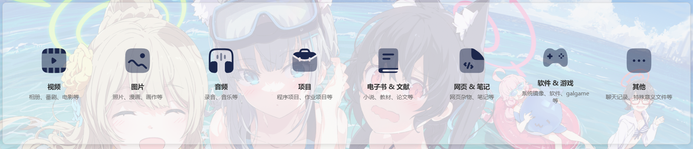

# 主界面

指在 `classify_shower` 模块在使用 `get_block()` 获取到的窗口内绘制的界面。相关逻辑主要在前端 `classify_shower.js` 中的 `classifyShowerInit()` 函数内。关于 `get_block()` 函数以及相关模块加载机制，请先阅读 [模块化设计文档](../../总设计文档/模块化设计思路.md) 中的说明，并建议在阅读本文档前先阅读该资料。

***

## 分类按钮

`classify_shower` 模块将所有的根目录视作一个统一的库，默认情况下其用于分类展示库里有的 “视频”、“图片”、“音频”、“项目”、“电子书”、“网页”、“软件&游戏”、“其他” 这8种资源。 

其初始化时根据全局变量 `cs_CLASSIFICATIONS` 的内容，默认将本模块自己的block从左到右分成 8 份 div 类别容器，每一份放一个 SVG 图标，图标下面用大些的字体标明类别名称。在每一个类别名称标签下面还要有对该分类的简单介绍，用略小的灰色字体。每一类的类别名称、图标、介绍内容分别是根据 `cs_CLASSIFICATIONS` 中的 `name`、`icon`、`description` 字段来填写的。这个全局变量的默认内容：

```js
const cs_CLASSIFICATIONS = [
    {
        name: '视频',
        icon: ...,
        description: '相册、番剧、电影等'
    },
    {
        name: '图片',
        icon: ...,
        description: '照片、漫画、画作等'
    },

    ......
    
    {
        name: '其他',
        icon: ...,
        description: '聊天记录、特殊意义文件等'
    }
];
```

这 8 份每一份在点击时要调用 eventlistener 展示对应的资源页面。



## 功能栏

在本模块自己的block主界面的右上角设有一个悬浮（`display: fixed`）的功能栏，为一半透明圆角 div，用于放置一些常用的功能按钮。

